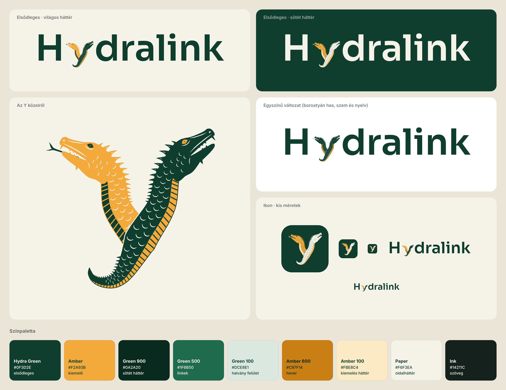

# Hydralink – logó és arculati alapok

Csak feliratból álló logó a Hydralink AI ügynökséghez. Az **y** betű egy kétfejű Hydra,
vízikígyóként megrajzolva: két kígyózó nyak emelkedik ki egy vastag törzsből, amely
hegyes farokban végződik. A felirat Sora SemiBold.

A rajz rétegzett: kis méretben a kétfejű sziluett és a hasi csík dolgozik, nagyobb
méretben jönnek elő a részletek – hasi pikkelylemezek a másik márkaszínnel, pikkelyminta
az oldalakon, fogsor, hasított pupilla, tarajsugarak, arcvonások, tüskesor a farkon is.



## Mitől hidra, és nem sárkány

A rajz több ábrázolási hagyományból merít:

- **Ókori görög vázaképek** – a Hydra „óriási vízikígyó”: egyetlen vastag törzsből
  sarjadó kígyófejek, szarv és szárny nélkül. Innen a kígyószerű fej és a közös törzs.
- **Reneszánsz és 19. századi festészet** (Pollaiuolo, Moreau) – felágaskodó, viperaszerű
  fejek. Innen a méregfogak és a villás nyelv.
- **Modern fantasy** (pl. D&D) – hosszú, kígyózó nyakak, a fejen és a nyakon taraj vagy
  tüskesor, hasított pupilla; a fejek nem egyformán állnak. Innen a hátrafelé simuló
  taraj a szarv helyett, és az, hogy a két fej nem tükörképe egymásnak: az egyik
  nyelvet ölt, a másik sziszeg.

## Fájlok

| Fájl | Mire való |
| --- | --- |
| `logo/hydralink-logo.svg` | Elsődleges logó, világos háttérre (átlátszó háttér) |
| `logo/hydralink-logo-on-dark.svg` | Elsődleges logó, sötét háttérre |
| `logo/hydralink-logo-mono.svg`, `…-mono-on-dark.svg` | Egyszínű változat – mindkét fej zöld, borostyán has, szem és nyelv |
| `logo/hydralink-icon.svg` | Ikon / favicon / profilkép (csak az y) |
| `brand/colors.css` | A paletta CSS változókként, a weboldalhoz |
| `tools/generate_logo.py` | A logót előállító szkript (minden paraméter itt hangolható) |
| `logo/archive/`, `tools/archive/` | Korábbi változatok (illusztratív, Draco, Nexus, sárkányfejes, egyszerűbb hidra) |

Az SVG-kben a betűk körvonallá vannak alakítva, így nem kell hozzájuk betűtípust telepíteni.
A Sora SIL Open Font License alatt szabadon használható, a weboldal címsoraihoz is.

## Színek

| Név | Hex | Szerep |
| --- | --- | --- |
| Hydra Green | `#0F3D2E` | Elsődleges: logó, címsorok, sötét szekciók háttere |
| Amber | `#F2A93B` | Kiemelő: gombok, apró hangsúlyok, a logó második színe |
| Green 900 | `#0A2A20` | Legsötétebb zöld: lábléc, sötét mód háttér |
| Green 500 | `#1F6B50` | Linkek, hover világos háttéren |
| Green 100 | `#DCE8E1` | Halvány zöld felület: kártyák, címkék |
| Amber 600 | `#C97F14` | A borostyán gomb hover/lenyomott állapota |
| Amber 100 | `#FBE8C4` | Kiemelés háttere, jelvények |
| Paper | `#F6F3EA` | Meleg törtfehér oldalháttér |
| Ink | `#14211C` | Folyószöveg világos háttéren |

Ökölszabály: a zöld viszi a szöveget és a felületeket, a borostyán a „szikra”.
A borostyán **kitöltő szín** – világos háttéren szövegnek ne használd (kontraszt 1,8:1),
sötétzöldön viszont bármire jó (6,1:1). Gombnál: borostyán háttér + sötétzöld szöveg.

## Újragenerálás

```
pip install fonttools shapely
python3 tools/generate_logo.py
```
